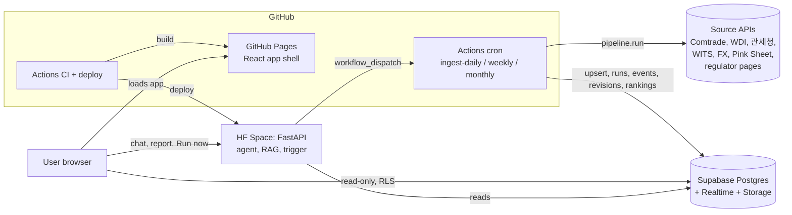

# WellGTM — Engineering Plan

| | |
|---|---|
| **Status** | v1, 2026-11-24 |
| **Implements** | [PRD](PRD.md) (this is the "engineering plan" referenced in PRD §8.3) |
| **Related** | [Gap analysis & M1 plan](gap_analysis_and_m1_plan.md) · [Data dictionary](data_dictionary.md) · [Decision & risk log](pm/07_decision_risk_log.md) |

---

## 1. Principles
1. **Automated, live data.** No data is committed to the repo by hand or by bot. Scheduled jobs pull from the source APIs into a live database, and the dashboard reads that database.
2. **Show the automation.** Every run, every step and every changed value is recorded and visible in the UI (§7, page 6).
3. **Provenance on every row.** Every row has `source`, `retrieved_at` and `run_id` (PRD FR-4.1, DR-4).
4. **Failure isolation.** One failing source never blocks the others (FR-3.1).
5. **The demo works when the backend is asleep.** Data reads go straight to Supabase. Only the agent depends on the API server (US-30).
6. **Python is the reference implementation** of the scoring. The browser re-ranks for custom weights and is checked against Python fixtures.

## 2. Architecture



| Layer | Stack | Host |
|---|---|---|
| CI/CD | `uv`, ruff, pytest; pnpm, vitest, Playwright | GitHub Actions |
| Ingestion workers | Python 3.12, pandas, pandera, SQLAlchemy Core, requests | GitHub Actions (cron + `workflow_dispatch`) |
| Database | Postgres, Realtime (live run feed), Storage (raw payloads) | Supabase free tier |
| API + agent | FastAPI, LangGraph, Chroma, local multilingual embeddings; Docker | Hugging Face Spaces (deployed from GitHub) |
| Frontend | Vite, React, TypeScript, TanStack Query, ECharts, Tailwind, supabase-js | GitHub Pages |
| Email | Brevo SMTP | Sent from the Actions job |

**Why Vite over Next.js:** GitHub Pages serves only static files. Next.js would need `output: 'export'`, which loses its server features anyway.

## 3. Repository layout
```
pipeline/          ingestion package (M1)
  config.py        candidates, HS codes, hubs, sanctions
  sources/         one adapter per source: fetch() -> DataFrame
  schema.py        pandera schemas per table
  db.py            table definitions, upsert with revision diff, run/event logging
  indicators.py    indicator + pillar build, scoring, P(TOP3)
  run.py           CLI: python -m pipeline.run --source X
supabase/migrations/  SQL generated from pipeline/db.py + RLS policies
api/               FastAPI app (M3/M4)
frontend/          Vite app (M3)
eval/              golden set, backtests, reports (M2–M6)
analysis/          exploratory analysis (kept; now calls pipeline.indicators)
tests/             pytest
.github/workflows/ ci, ingest-*, deploy-*
```

## 4. Data sources

| Source | Table | Endpoint | Key | Cadence | What a run detects |
|---|---|---|---|---|---|
| UN Comtrade (annual, HS4) | `trade_flows` | `comtradeapi.un.org/public/v1/preview/C/A/HS`; with key: `/data/v1/get/C/A/HS` | Optional (free key lifts the 500-row cap) | Weekly | New reporter-years; revisions to past values |
| World Bank WDI + LPI | `country_indicators` | `api.worldbank.org/v2/country/{iso}/indicator/{code}` | No | Weekly | New years; revisions |
| 관세청 monthly exports (HS10 × country) | `trade_flows` (`freq=M`) | data.go.kr 관세청 품목별 국가별 수출입실적 (verify the exact operation during M1) | Yes (free) | Weekly | A newly published month |
| WITS tariffs + overrides | `tariffs` | WITS SDMX API + `pipeline/tariff_overrides.yaml` | No | Weekly | Rate changes, effective dates |
| FX | `fx_rates` | `open.er-api.com/v6/latest/USD` (covers VND, KZT, PKR, which ECB-based feeds lack) | No | Daily | New rates; FX-swing signal (M5) |
| World Bank Pink Sheet | `commodity_prices` | CMO historical monthly workbook (URL configurable; it changes each release) | No | Monthly | A new month (cocoa, sugar, wheat, palm oil) |
| Regulator pages | `reg_documents` | Monitored URL list (FDA, GACC, BPJPH, JAKIM, FSSAI, GSO, EU) | No | Daily | Content-hash change → new version, re-embed (M4) |
| Google Trends | `country_indicators` | Manual snapshot (D10) | — | Manual | — |

Terms: link and summarise KOTRA/aT material (R11). The FX feed requires attribution in the UI footer.

## 5. Ingestion flow
Each `python -m pipeline.run --source X` executes these steps. Each step writes an `ingest_events` row, so the dashboard shows progress live.

1. **start**: insert an `ingest_runs` row (`status=running`, `trigger=schedule|manual|ci`, GitHub run URL).
2. **fetch**: call the source adapter → DataFrame. Upload the raw payload to Supabase Storage at `raw/{source}/{run_id}`.
3. **validate**: pandera schema for the target table. Failing rows are counted and dropped; if more than 20% fail, the run fails.
4. **upsert**: compare against existing rows by natural key → insert new rows, update changed rows, and write one `data_revisions` row per changed field. Unchanged rows are left alone, so re-runs are idempotent.
5. **rerank**: if any data changed, recompute pillars, scores and P(TOP3) for each category × preset and insert a `ranking_snapshots` row.
6. **finish**: set the status, counts and duration. If a source fails, its run is marked failed and the next source continues. The job exits non-zero so GitHub shows it red.

Steps 7–8 arrive in M5: anomaly detection on the changed rows, then email.

**Schedules:** `ingest-daily.yml` at 17:00 UTC (02:00 KST): fx, regulation. `ingest-weekly.yml` on Monday: comtrade, wdi, kcs_monthly, tariffs. `ingest-monthly.yml` on the 5th: pinksheet. All three accept `workflow_dispatch` with a `source` input.

**Keeping schedules alive:** GitHub disables schedules after 60 days with no repo activity, so a keepalive step uses the API to re-enable the workflow. Supabase pauses free projects after 7 days idle; the daily job prevents that.

## 6. API contract (FastAPI, M3–M4)
| Method | Path | Purpose |
|---|---|---|
| GET | `/v1/health` | Component readiness: db, rag, llm |
| GET | `/v1/rankings?category&preset&include_hubs` | Latest ranking snapshot (also readable directly from Supabase) |
| GET | `/v1/countries/{iso3}` | Profile: indicators with provenance, Korea exports by HS, mirror gap, tariffs |
| GET | `/v1/pipeline/runs?source&limit` | Run history with event counts |
| POST | `/v1/pipeline/trigger` `{source}` | Calls GitHub `workflow_dispatch`. Rate-limited to 3/hour, signed-in users only |
| POST | `/v1/agent/chat` (SSE) | Agent turn: typed events, validated `ui_actions` in the final event |
| POST | `/v1/agent/report` | TOP3 report (Markdown) |

CORS allows only the GitHub Pages origin.

## 7. Dashboard pages
View state (category, preset, weights, filters, focus country) lives in the URL so every view can be shared.

| # | Page | Widgets | Data |
|---|---|---|---|
| 1 | Overview | KPI tiles (Korea exports, YoY value vs volume), TOP3 cards with P(TOP3), "data updated N h ago" | `ranking_snapshots`, `trade_flows`, `ingest_runs` |
| 2 | Screening | Preset and category selectors, weight sliders (re-rank in a Web Worker), ranked table with P(TOP3) bars, country × pillar heatmap, hub/sanction toggles, TOPSIS agreement | pillar table from the latest snapshot |
| 3 | Country profile | Indicator list with source, year, coverage badge; Korea exports by HS; mirror gap warning (> ±30%); tariffs with effective dates; forecast with interval | `country_indicators`, `trade_flows`, `tariffs` |
| 4 | Category explorer | Value vs volume vs unit-price lines per HS; commodity price overlay (cocoa) | `trade_flows`, `commodity_prices` |
| 5 | Compare | 2–4 countries side by side, pillar radar or bar | snapshot |
| 6 | **Automation & Data Health** | Live run feed (Realtime), per-source freshness and next run, "Run now", run detail (rows added/revised/failed, old → new), coverage matrix, ranking-history chart | `ingest_runs`, `ingest_events`, `data_revisions`, `ranking_snapshots` |
| 7 | Alerts (M5) | Alert history with evidence links | `alerts` |
| 8 | Report | TOP3 report preview, Markdown export, print to PDF | API |

The agent chat is a right-hand panel on pages 1–5.

## 8. Scoring and forecasting
- **Scoring:** as in [03 §3](pm/03_data_analysis.md#3-preliminary-screen-hypothesis-only): winsorised min-max normalisation, pillar means, weighted sum, and P(TOP3) under ±20% and Dirichlet weights. Imputed pillar values are flagged and never filled silently. Growth also gets a log-linear slope (2019–25) as an alternative to the endpoint CAGR, which depends on the 2020 base year.
- **Ranking backtest (M2):** score with 2015–19 data only; report the Spearman ρ against actual 2020–25 Korean export growth.
- **Forecasting:** annual series have about 10 points, so the models are naïve, drift, damped ETS and log-linear trend, chosen per series by rolling-origin backtest against the naïve baseline (PRD §5.2). Monthly forecasts use the 관세청 series only. No Prophet (D19).

## 9. Security
- The browser gets only the Supabase anon key. RLS allows `select` on data tables and denies all writes.
- Writes use the service-role key, stored in GitHub Actions secrets.
- The GitHub token for `workflow_dispatch` is fine-grained (actions:write on this repo only) and lives in the HF Space secrets.
- Only public data in 예선 (PRD §10).

## 10. Testing
- **pytest:**
  - source adapters, tested with recorded responses;
  - validation;
  - upsert idempotency and revision diffs, on SQLite (with an optional Postgres run when `DATABASE_URL` is set);
  - reproducing the [03](pm/03_data_analysis.md) screen from `analysis/data/`.
- **CI** checks that the committed migration matches the DDL generated from `pipeline/db.py`.
- **Frontend (M3):** vitest parity between TypeScript and Python scoring fixtures; Playwright for re-rank latency and the Automation page.
