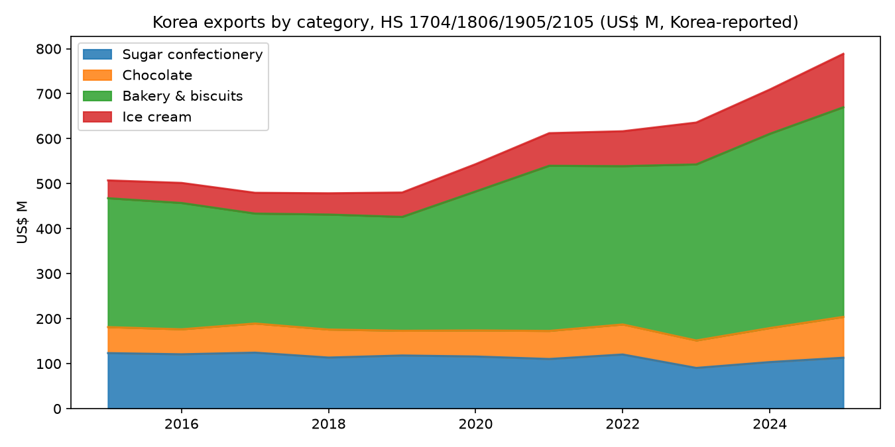
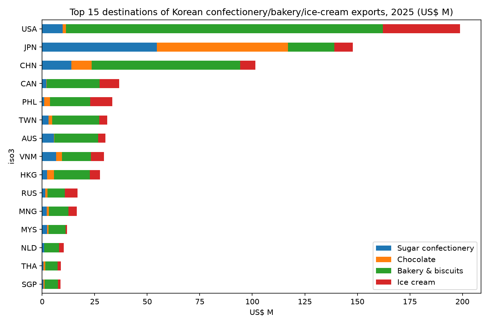
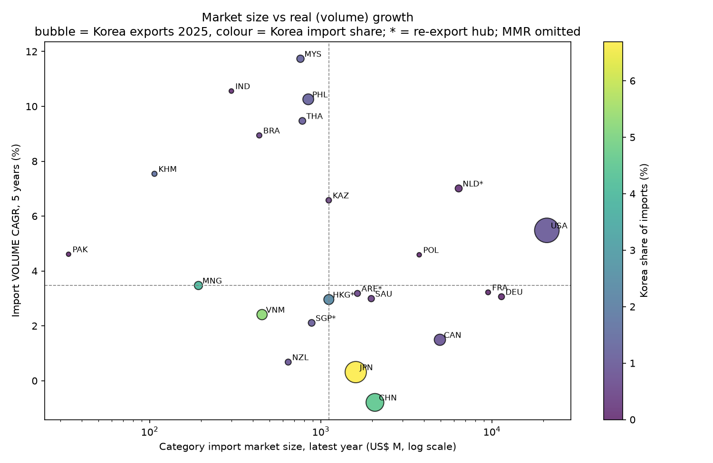
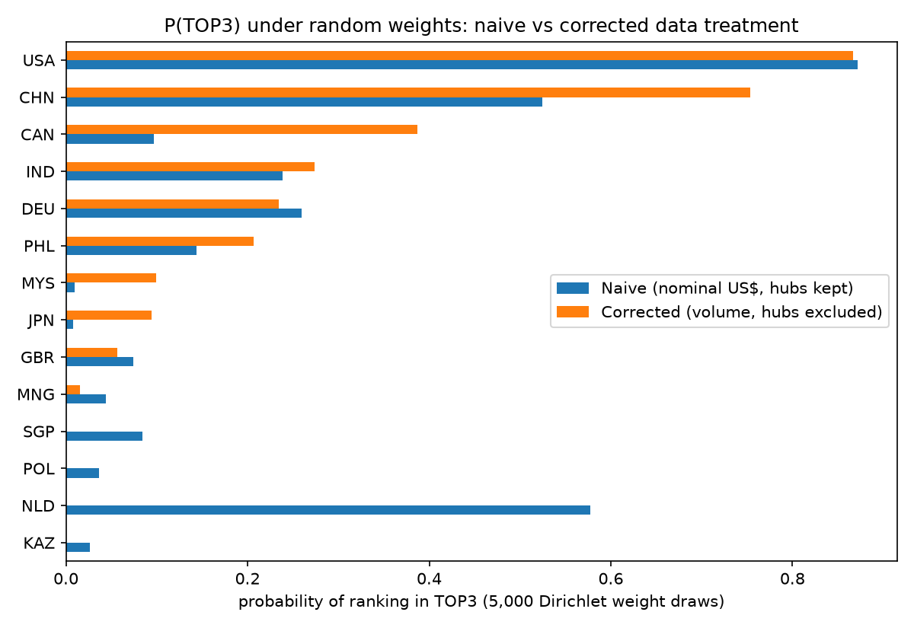

# 03 — Exploratory Data Analysis

> **Purpose.** Before we design any product, test whether public data can actually answer "which 3 countries should Lotte Wellfood prioritise for K-food exports?". Find what the data says, where it misleads, and what that means for product requirements.
>
> **Status:** Preliminary analysis for the 예선 stage. Rankings here are **hypotheses**, not recommendations: the consumer-trend, tariff and regulation pillars are not yet included.
>
> **Reproduce:** `python analysis/collect.py && python analysis/analyze.py` (outputs in `analysis/output/`, figures in `docs/pm/figures/`).

---

## 1. Scope & data

| Item | Choice |
|---|---|
| Categories (HS 4-digit) | 1704 Sugar confectionery · 1806 Chocolate & cocoa preparations · 1905 Bakery, biscuits, wafers · 2105 Ice cream |
| Candidate countries | 30: USA, CAN, MEX, BRA, GBR, DEU, FRA, NLD, POL, CHN, JPN, TWN, HKG, MNG, VNM, THA, IDN, PHL, MYS, SGP, KHM, MMR, IND, PAK, KAZ, AUS, NZL, ARE, SAU, RUS |
| Years | 2015–2025 (annual) |
| Trade data | UN Comtrade public API: (a) each country's imports from World and from Korea (partner-reported, CIF); (b) Korea's exports to each country (Korea-reported, FOB) |
| Macro data | World Bank WDI: GDP per capita, GDP growth, population, urbanisation, household consumption per capita, inflation, Logistics Performance Index (LPI) |
| Retrieved | 2026-10-29 (timestamp stored in every raw row) |

The 30 candidates cover **96.6%** of Korea's 2025 exports in these four categories.

---

## 2. Key findings

### F1. Korea's exports in these categories are growing in value, not volume

| Category | 2020 (US$ M) | 2025 (US$ M) | Value CAGR 20–25 | **Volume CAGR 20–25** | 2025 YoY value |
|---|---:|---:|---:|---:|---:|
| Sugar confectionery (1704) | 116.0 | 113.2 | −0.5% | **−9.2%** | +9.3% |
| Chocolate (1806) | 57.9 | 90.8 | +9.4% | **−5.0%** | +20.1% |
| Bakery & biscuits (1905) | 309.0 | 465.9 | +8.6% | **+4.3%** | +7.9% |
| Ice cream (2105) | 60.7 | 118.7 | +14.4% | **+13.1%** | +20.7% |
| **Total** | **543.5** | **788.6** | **+7.7%** | **≈0.0%** | **+11.2%** |

- Total shipped volume is flat over five years, so the value growth comes from price and product mix.
- **Ice cream is the only category with strong real growth.** Its exports nearly doubled, and the growth is almost all volume.
- Chocolate's value growth hides a volume decline (cocoa price shock, see F3).

### F2. Exports are concentrated: the USA, Japan and China take 57%

| Rank | Destination | 2025 exports (US$ M) | CAGR 20–25 | Largest category |
|---|---|---:|---:|---|
| 1 | USA | 198.8 | +12.5% | Bakery 150.9, Ice cream 36.6 |
| 2 | Japan | 147.9 | +3.6% | Chocolate 62.3, Sugar conf. 54.6 |
| 3 | China | 101.4 | +5.3% | Bakery 70.6 |
| 4 | Canada | 36.6 | +14.1% | Bakery 25.1 |
| 5 | Philippines | 33.4 | +19.7% | Bakery 19.2, Ice cream 10.5 |
| 6 | Taiwan | 31.0 | −0.8% | Bakery 22.5 |
| 7 | Australia | 30.0 | +5.6% | Bakery 20.7 |
| 8 | Vietnam | 29.5 | +1.8% | Bakery 13.8 |
| 9 | Hong Kong | 27.5 | −1.5% | Bakery 17.1 |
| 10 | Russia | 16.8 | +12.7% | Bakery 8.2 |

The top 3 take **56.8%** of exports and the top 10 take **82.8%**. That is a diversification argument: one US tariff change moves a quarter of the business.

Fastest-growing destination × category pairs with at least US$3M in 2025: Japan ice cream (+61%/yr), Mongolia ice cream (+48%) and bakery (+39%), Australia ice cream (+31%), Russia ice cream (+28%), USA sugar confectionery (+22%), Philippines bakery (+20%), USA ice cream (+19%). Full list: `analysis/output/t8_fastest_growing_country_category.md`.

### F3. Destination markets: nominal growth overstates demand
In nominal US$, almost every market grew 10–15% a year. Splitting import growth into **volume** and **unit price** gives a different picture:

| Country | Import value CAGR (5y) | **Import volume CAGR (5y)** | Unit-price CAGR |
|---|---:|---:|---:|
| Malaysia | 13.1% | **11.7%** | 1.3% |
| India | 18.4% | **10.6%** | 7.0% |
| Philippines | 14.8% | **10.3%** | 4.1% |
| Thailand | 12.1% | **9.5%** | 2.4% |
| Brazil | 16.1% | **8.9%** | 6.6% |
| USA | 12.8% | 5.5% | 6.9% |
| Germany | 12.3% | 3.1% | 9.0% |
| Canada | 9.8% | 1.5% | 8.2% |
| Japan | 7.2% | 0.3% | 6.9% |
| China | 4.6% | **−0.8%** | 5.4% |
| Kazakhstan | 20.2% | 6.6% | 12.8% |

Across the 25 markets with 2025 data, **chocolate import value rose 21.7% in 2025 while volume fell 13.3%**. That is the cocoa price shock, not demand.

The chart's upper-right quadrant (large and growing in real terms) has only the **USA** (with NLD, a hub). The upper-left (smaller but growing fast) is **Southeast Asia (MYS, PHL, THA), India and Brazil**. Large, mature markets (JPN, CHN, CAN, DEU, FRA) sit below the volume median.

### F4. Mirror data disagrees, sometimes by a lot
For the same Korea → country flow, Korea's reported exports and the partner's reported imports should be similar (CIF imports are usually ≈5–10% higher). They often aren't:

| Country | Korea-reported exports (US$ M) | Partner-reported imports from Korea | Ratio |
|---|---:|---:|---:|
| Philippines | 33.4 | 10.3 | **0.31** |
| India | 0.57 | 0.24 | 0.42 |
| Mexico | 3.2 | 1.6 | 0.50 |
| Japan | 147.9 | 107.1 | 0.72 |
| USA | 198.8 | 204.5 | 1.03 |
| France | 1.7 | 2.7 | 1.60 |
| Poland | 0.23 | 0.91 | 3.93 |

Likely causes are transshipment, HS classification differences, under-declaration, and timing. Implication: **use Korea-reported exports as the main measure of Korean momentum**, and show partner-reported figures only as context.

### F5. Coverage gaps
- **Taiwan** is not a Comtrade reporting country and isn't in WDI, even though it is Korea's #6 destination (US$31M). We need a separate source, such as Taiwan's customs portal, or must label it as Korea-side-only data.
- **Vietnam, the UAE and Mongolia** have no 2024–2025 import reports yet. **Russia** has none after 2021.
- **Myanmar** data is unusable after 2021 (−47%/yr reported imports, political crisis).
- Full matrix: `analysis/output/t4_coverage_hs_count.md`.

### F6. Re-export hubs distort a naïve screen
Hong Kong, Singapore, the Netherlands and the UAE import goods that are consumed elsewhere. In a naïve screen (nominal US$, hubs included), **the Netherlands ranked #3**. After switching growth to volume and removing hubs, it drops out (figure below).

### F7. Countries with Lotte plants look weak on Korean exports
India, Kazakhstan, Pakistan, Russia and Myanmar show very low Korean exports. This is expected: Lotte Wellfood produces locally there (to be confirmed in the market analysis). A Korea-export-only score would wrongly rank these as unattractive. The product needs an **entry-mode lens**: *export from Korea* vs *expand local production*.

---

## 3. Preliminary screen (hypothesis only)

**Method:**
- Four pillars, each the average of min-max normalised indicators (5–95% winsorised, log for size measures):

| Pillar | Weight | Indicators |
|---|---:|---|
| Market growth | 0.30 | import **volume** CAGR, average GDP growth 2021–25, household consumption per capita CAGR |
| Market size | 0.25 | log category imports, log population, log GDP per capita |
| K-momentum (trade) | 0.30 | Korea export CAGR 2020–25, log Korea exports 2025 |
| Entry ease | 0.15 | LPI |

- Excluded: hubs (HKG, SGP, NLD, ARE), sanctioned (RUS), and Taiwan (missing data).
- Robustness was tested two ways: (a) ±20% random changes to the default weights, and (b) 5,000 completely random weight vectors (Dirichlet), the second approximating "any weighting a manager might choose".

| Rank | Country | Score | P(TOP3), ±20% weights | P(TOP3), any weights |
|---|---|---:|---:|---:|
| 1 | USA | 77.3 | 1.00 | 0.87 |
| 2 | China | 73.4 | 1.00 | 0.75 |
| 3 | Philippines | 65.4 | 0.91 | 0.21 |
| 4 | India | 62.9 | 0.05 | 0.27 |
| 5 | Malaysia | 62.0 | 0.00 | 0.10 |
| 6 | Canada | 61.9 | 0.05 | 0.39 |
| 7 | Thailand | 58.3 | 0.00 | 0.00 |
| 8 | UK | 58.2 | 0.00 | 0.06 |
| 9 | Vietnam | 58.2 | 0.00 | 0.00 |
| 10 | Japan | 56.9 | 0.00 | 0.09 |

**Reading:**
- **The USA and China are robust TOP3 members.** China's case rests on size and existing Korean momentum, not on real market growth (volume −0.8%/yr).
- **The third slot depends on business priorities, not on the data.** The Philippines wins under default weights; Canada wins if size and stability matter more; India wins if growth matters most. **This is the core product insight: the tool must make the weight trade-off explicit and show how stable the TOP3 is, not output one "answer".**
- Two likely strategy lenses appear:
  - **"Scale" markets:** USA, China, Canada, Japan. Large, with an existing Korean presence.
  - **"Growth/entry" markets:** Philippines, Malaysia, India, Thailand, Vietnam. Fast real growth, low Korean share (about 1%), so lots of room to grow.

---

## 4. Limitations of this analysis
1. **No consumer-trend pillar yet.** Google Trends / Hallyu indicators come in Phase 1 data work.
2. **No tariff or regulation pillar yet.** WITS tariffs and halal/labeling rules can change rankings sharply (e.g. Indonesia's halal mandate, US tariffs).
3. HS 4-digit codes are broad. HS 1905 mixes Pepero-type biscuit sticks with bread, and HS 2105 covers all ice cream. Product-level fit needs HS 6-digit data or 관세청 10-digit data. Our 4-code scope (US$611M in 2024 excluding ice cream) is also narrower than MAFRA's "과자류" (US$770M), which includes savoury snacks.
4. Net weight (kg) is missing for some records, so volume CAGRs are indicative only.
5. Annual data gives only ~10 points per series, so forecasting must use simple, backtested models (as planned) and show uncertainty bands.
6. LPI is from 2023 only and is a coarse proxy for logistics ease.

---

## 5. Requirements this analysis creates

| ID | Requirement | Source finding |
|---|---|---|
| DR-1 | Growth indicators use **volume** (or deflated value) by default. Nominal values remain visible, with a "price effect" breakdown. | F1, F3 |
| DR-2 | Re-export hubs are **flagged and excluded by default** (user can include them). | F6 |
| DR-3 | Korea-reported exports are the main measure of Korean momentum. Mirror data is shown with a discrepancy warning above ±30%. | F4 |
| DR-4 | Every indicator shows **data year and coverage**. Missing data is never silently filled; imputed values are badged. | F5 |
| DR-5 | Ranking output always includes **TOP3 probability under weight uncertainty**, not only point scores. | §3 |
| DR-6 | Two default presets: **"Scale markets"** and **"Growth/entry markets"**, plus custom weights. | §3 |
| DR-7 | An **entry-mode lens**: countries with existing Lotte production are scored on market attractiveness and labeled "local production", not penalised for low Korean exports. | F7 |
| DR-8 | Category filter (HS 1704/1806/1905/2105) changes the whole ranking, because category stories differ (ice cream ≠ chocolate). | F1, F2 |
| DR-9 | A cocoa or other commodity price shock must be visible as context, so users don't misread nominal chocolate growth. | F1, F3 |
| DR-10 | Taiwan needs an alternative data source or an explicit "partial data" badge. | F5 |
