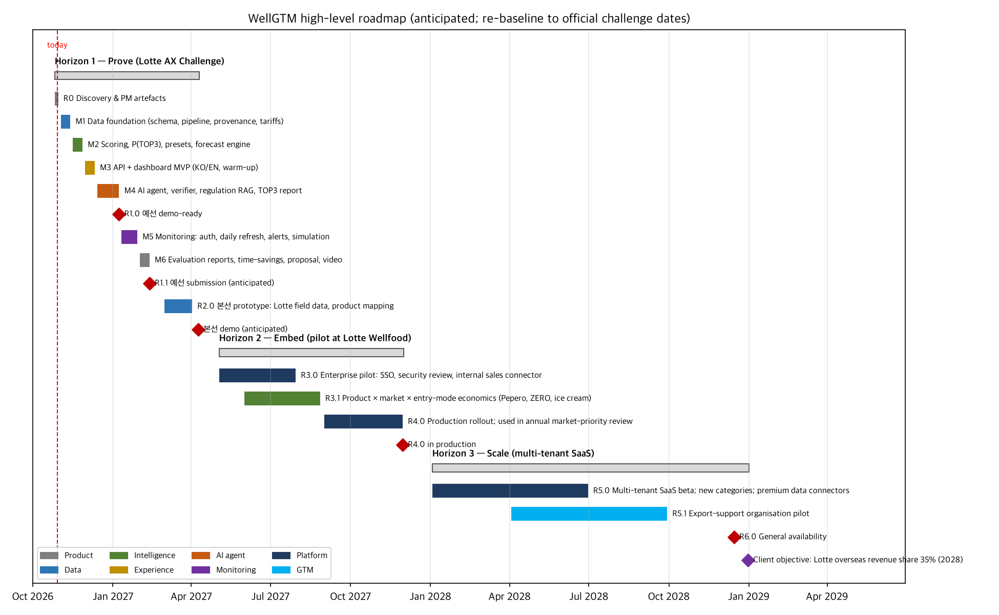

# 11 — High-Level Product Roadmap

> Strategic overview of major releases and **anticipated** timelines, aligned with Lotte Wellfood's long-term objectives and the [product vision](00_product_vision.md).
> - The milestone detail for the challenge build is in [05_roadmap.md](05_roadmap.md).
> - **Timeline caveat:** the official 예선/본선 dates have not been published to us. Windows below are planning assumptions and must be **re-baselined** once the challenge schedule is confirmed. Dates beyond the challenge are directional.

**Files for Microsoft tools** (generated from one source, [`analysis/pm_config.py`](../../analysis/pm_config.py)):
- **Microsoft Project:** open [`WellGTM_roadmap_MSProject.xml`](workbooks/WellGTM_roadmap_MSProject.xml) directly (File → Open → XML format). Or import [`WellGTM_roadmap_MSProject_import.csv`](workbooks/WellGTM_roadmap_MSProject_import.csv) with the Import Wizard.
- **Microsoft Excel:** [`WellGTM_market_research.xlsx`](workbooks/WellGTM_market_research.xlsx), sheet `Roadmap` (monthly Gantt grid).

---

## 1. Alignment with client objectives
| Client objective (Lotte Wellfood) | Source | Roadmap response |
|---|---|---|
| Overseas revenue share **35% by 2028** (from ~28.6% in 2025) | [02 §3.1](02_market_analysis.md#31-snapshot), [02 §1](02_market_analysis.md#1-executive-summary) | H1 proves the TOP3 method → H2 embeds it in the annual market-priority review before 2028 planning cycles |
| **Pepero** as a global mega brand (top-10 global snack by 2035), priority SEA and North America | [02 §3.3](02_market_analysis.md#33-export-product-portfolio) | R3.1 adds product-level (Pepero, ZERO, ice cream) × market × entry-mode recommendations |
| **ONE INDIA**: ₩1T India revenue by 2032; regional hubs (India, Kazakhstan) | [02 §3.2](02_market_analysis.md#32-footprint--strategic-stance-by-country) | Entry-mode lens (H1) → entry-mode economics using existing plants as hubs (R3.1) |
| Margin recovery under cocoa and tariff pressure | [02 §7](02_market_analysis.md#7-macro-risks) | Value-vs-volume, tariff overrides, FX alerts (H1); internal margin data in H2 |
| Diversification away from concentrated markets | [03 F2](03_data_analysis.md#f2-exports-are-concentrated-the-usa-japan-and-china-take-57) | Concentration view (Could → H2) |

## 2. Now / Next / Later

| | **Now: Horizon 1, Prove** (Nov 2026 – Apr 2027, anticipated) | **Next: Horizon 2, Embed** (May – Nov 2027, anticipated) | **Later: Horizon 3, Scale** (2028, directional) |
|---|---|---|---|
| **Customer outcome** | A defensible TOP3 with evidence; judges and Lotte stakeholders accept the method | WellGTM used in Lotte's real market-priority review and quarterly business reviews | Multiple paying tenants; monitoring drives renewals |
| **Data** | Public trade, macro, tariff and trend data with provenance; corrections by default | Lotte internal sales, distributor and price data; product-level HS mapping | Premium data connectors; more categories and origin countries |
| **Intelligence** | MCDA + P(TOP3) + presets + forecasts; entry-mode lens | Product × market × entry-mode economics; outcome back-testing | Tenant-specific models and presets; anonymised benchmarks (opt-in) |
| **AI agent** | Tools + verifier + citations; regulation RAG; TOP3 report | Agent over internal data with access control; scheduled reports | Multi-tenant agent with per-tenant corpora |
| **Monitoring** | Daily refresh, anomaly alerts, email briefs, simulation | Messenger/Teams delivery; alert tuning from feedback | Portfolio-level monitoring across tenants |
| **Platform** | Free-tier cloud; KO/EN; public data only | SSO, security review, audit log, private LLM endpoint option | Multi-tenancy, billing, admin console, SLAs |
| **Exit signal** | 예선 submission → 본선 demo with field data | In production for the annual review | General availability; non-design-partner customers |

## 3. Release plan

| Release | Window (anticipated) | Major features | Primary personas | Success measure |
|---|---|---|---|---|
| **R0 Discovery** ✅ | Oct 2026 | Problem discovery, market and data analysis, PRD, vision, VPC, personas | — | Docs reviewed |
| **R1.0 예선 demo-ready** | Nov 2026 – early Jan 2027 | Data foundation (M1), scoring + P(TOP3) + forecast (M2), dashboard (M3), AI agent + regulation RAG + TOP3 report (M4) | A, C, D, F | Golden-set targets met; p95 re-rank ≤ 500 ms |
| **R1.1 예선 submission** | Jan – Feb 2027 | Monitoring: login, watchlists, daily refresh, anomaly alerts, email briefs, simulation (M5); evaluation reports + proposal (M6) | B, D, E, judges | Daily job green 7 runs in a row; time to TOP3 < 5 min (measured) |
| **R2.0 본선 prototype** | Mar – Apr 2027 | Lotte field data through the common schema; product-level mapping; field-data validation | A, C | Rankings reproduced with field data; stakeholder acceptance |
| **R3.0 Enterprise pilot** | May – Jul 2027 | SSO, security review, internal sales connector, audit log | C, G | Security sign-off; pilot users active weekly |
| **R3.1 Product × market × entry mode** | Jun – Aug 2027 | Recommendations per brand (Pepero, ZERO, ice cream) and entry mode (export / distributor / local plant) | A, F | Used in at least one entry decision |
| **R4.0 Production rollout** | Sep – Nov 2027 | Hardening, Teams/email delivery, scheduled exec reports | All | Used in the annual market-priority review |
| **R5.0 Multi-tenant SaaS beta** | H1 2028 | Multi-tenancy, new categories, premium data connectors, admin and billing | New tenants | ≥ 1 additional customer in beta |
| **R5.1 Export-support org pilot** | Q2–Q3 2028 | SME advisory mode, white-label reports | Advisors | Pilot with one agency |
| **R6.0 General availability** | Dec 2028 | SLAs, support, pricing tiers | All | Paying tenants beyond the design partner |

## 4. Dependencies & critical path
- **Critical path (H1):** M1 Data → M2 Scoring → M3 Dashboard → M4 Agent → R1.0. Monitoring (M5) depends on the scoring and dashboard work.
- **R2.0** depends on 본선 field data being provided (format unknown → common schema with a `source` tag).
- **R3.x** depend on Lotte IT/security engagement and data-sharing agreements.
- **R5.x** depend on proof of value in H2 (renewal and usage evidence).

## 5. Roadmap risks
| Risk | Impact on timeline | Mitigation |
|---|---|---|
| Official challenge dates earlier than assumed | Compress R1.0/R1.1 | Scope-cut order in [05 §3](05_roadmap.md#3-scope-cut-order-if-we-run-short): monitoring features cut first, provenance/verifier/eval never |
| Field data arrives late or in an unexpected format | R2.0 slips | Common schema; field-data adapter as a small, isolated module |
| Enterprise security review takes longer | R3.0 slips | Prepare security overview, data-flow diagram, private-LLM option early |
| No second customer for SaaS | R5.0 slips | Validate Segment 2 with export-support organisations during H2 |

## 6. Governance
- **Review cadence:** roadmap reviewed at the end of each milestone; dates re-baselined when the challenge schedule is confirmed.
- **Change rule:** a new item can only enter "Now" if it traces to a validated pain ([08](08_value_proposition_canvas.md)) or a scoring criterion, and something of equal size leaves.
- **Single source:** edit [`analysis/pm_config.py`](../../analysis/pm_config.py), then run `python analysis/build_pm_artifacts.py` to regenerate the Project, Excel and PNG versions.
